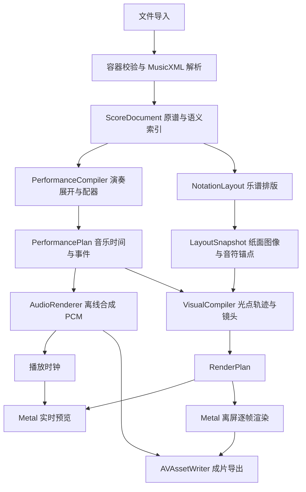

# Mac 应用技术架构

## 总体结构

建议采用原生 Mac 外壳，并将曲谱、演奏、排版和画面分开。SwiftUI 负责常规界面；AppKit 承接文档、菜单、文件选择与 Metal 视图集成。少量本地 WebKit 只用于成熟乐谱库的排版工作，不负责音频时钟或逐帧视频。

## 模块及边界

| 模块 | 职责 | 不承担的职责 |
| --- | --- | --- |
| MacApp | 文档窗口、导入、选项、播放控制、导出进度 | 音乐时序解析 |
| ProjectStore | 文件读写、原谱保护、自动保存、版本迁移、内容校验 | 保存运行中的音频节点 |
| ScoreCore | MusicXML 解析、稳定 ID、分数拍值、特性报告、语义查询 | 依赖像素坐标解释音乐 |
| PerformanceCore | 反复展开、速度解释、配器、奏法、绝对时间、音符实例 | 页面排版与界面刷新 |
| NotationLayout | MusicXML 到 SVG、音符符头与小节包围盒、分页 | 生成最终的演奏事件 |
| AudioCore | 音源准备、离线采样合成、混音、PCM 缓存与播放 | 通过屏幕帧数计时 |
| VisualCore | 轨迹规则、颜色、光点包络、镜头计划和帧状态计算 | 全局随机数或增量物理模拟 |
| MetalRenderer | 纸面、文字纹理、光球、光轨、Bloom、色调映射 | 导入解析和逐帧排版 |
| ExportCore | 固定时间取样、视频编码、音轨封装、取消与错误处理 | 录制屏幕窗口 |

这些是代码职责边界，初期可放在少量 Swift Package targets 中，不必立刻建立九个独立仓库或复杂插件系统。建议先用 `ScoreCore`、`PlaybackCore`、`VisualCore`、`PlatformMedia` 和 `MacApp` 五组组织源码。

## 数据契约

### ScoreDocument

包含原始 MusicXML 字节、归一化只读副本、曲谱索引、结构化诊断及项目设置。索引需要区分 `part`、`staff`、`voice`、`measure`、`note`、和弦组、连奏组、延音链及乐器声明。谱表不是声部，左右手也不能永远按高低谱表推断。

连奏组与延音链保留稳定的 `slurGroupId`、`tieChainId` 和端点。它们是发光连接的资格来源；只有声音时值重叠、音符相邻或音量相近时，不推断额外连接。关系无效或无法解析时，报告并降级为光点。

所有音乐位置使用约分后的有理数，单位为四分音符拍。MusicXML 的 `divisions`、`backup`、`forward`、`chord` 和连音组必须正确解释。每个 part 独立推进文档游标，再建立对齐的全曲拍轴；不能把所有 XML 音符按出现顺序串起来。[MusicXML 官方结构说明](https://www.w3.org/2021/06/musicxml40/tutorial/midi-compatible-part/)

### PerformancePlan

编译生成不可变快照，包含：

- `occurrenceId`：反复或跳转展开后，每次实际演奏的独立身份。
- `sourceNoteIds`：一个发声事件可能覆盖延音链的多个印刷音符。
- `notationAnchors`：各印刷音符在该次演奏中的视觉激活时间。
- `relationInstanceId`：将源谱连奏组与延音链绑定到本次展开的演奏；区分反复中的不同实例，保留延音锚点转移而不增加起音。
- `instrumentInstanceId`：音符开始时选定的合成实例，直到释放结束保持归属。
- `onSample`、`keyOffSample`、控制事件及增益包络；最终尾音长度由音频阶段补充。
- `tempoMap`、播放顺序、源谱位置到展开时间的双向索引、稳定的事件排序。

`onSample` 等以目标采样率计算。音乐拍值是语义主坐标，采样时间是媒体输出坐标。排版改动不改变演奏时间；音源更换不改变印刷音符的位置。

### LayoutSnapshot

包含固定页面尺寸、纸页变换、SVG、分辨率明确的纹理瓦片、小节与谱表包围盒，以及 `sourceNoteId → notehead anchors`。锚点指向符头，不能用包含符干、连梁、歌词的整个音符包围盒中心。

一个源音符允许对应多个图形锚点，例如分解显示或特殊排版。重复演奏则通常共用原来的印刷锚点，由 `occurrenceId` 区分时间。隐藏音符、提示音符和打击乐符头需有显式处理策略。

### RenderPlan

包含布局快照引用、演奏实例与锚点绑定、颜色方案、轨迹段、镜头曲线、随机种子及版本。`frameState(at:)` 只读这些数据与绝对时间；从任意时间开始取帧，应得到同样结果。

轨迹段分为 slur 内的连奏短拖尾与 tie 的持音连接。VisualCompiler 先检查音乐关系，再处理显示模式、和弦配对及几何约束；模式或覆盖不能给无关系音符补线。规则版本进入渲染计划及缓存 key，避免复用旧的相邻音符连线结果。

## 排版方案

**首选在本地 WKWebView 中运行固定版本的 OpenSheetMusicDisplay，使用 SVG 后端。** 它负责 MusicXML 排版，公开图形模型可提供音符图形及符头 SVG。[OSMD 官方介绍](https://opensheetmusicdisplay.org/)、[音符图形接口](https://opensheetmusicdisplay.github.io/classdoc/classes/VexFlowGraphicalNote.html)

具体工作链为：

1. 以固定宽度、字体和排版参数加载本地 MusicXML；禁用自动随窗口重排。
2. 等待字体就绪和最终排版完成，再提取 SVG 与符头几何。完整图形树生成前不建立最终锚点。
3. 在适配层把原谱语义 ID 关联到 OSMD 的源音符对象，再关联到图形对象。不能按 SVG 节点序号或浮点坐标猜测身份。原谱 ID 是否透传、和弦中符头对应关系是 P0 的硬门槛。
4. 使用同一 SVG 坐标变换提取锚点并栅格化纸面图像。SVG 单位、CSS 像素、设备像素和纹理像素必须显式区分。
5. 页面或瓦片图像、锚点及排版参数一起生成 `layoutHash`，交给原生渲染层。

SVG 栅格化在 P0 比较两条路径：受控尺寸的本地 WebKit 离屏页面绘制，以及能完整支持该 SVG 子集的原生绘制适配器。若 WebKit 的快照尺寸、离屏可见性或内存限制影响 4K，先采用分瓦片绘制；不能用低分辨率截图放大作为最终方案。首版外部素材不允许包含脚本或网络资源。

OSMD 的公开接口不等于已经验证其能覆盖全部参考曲谱。固定发行版本与所需字体，维护适配层，使用兼容性语料决定支持范围。MXL 由本应用先解包，再交付明确的一份 MusicXML，避免依赖库对压缩容器的特殊假设。

**备选为 Verovio。** 它提供 SVG、MusicXML 导入及时间映射等能力，但 MusicXML 转换和其 MIDI 时间映射存在支持边界，且采用 LGPL；不把其 MIDI 输出作为本应用音乐时序的唯一来源。[输入格式](https://book.verovio.org/toolkit-reference/input-formats.html)、[输出格式](https://book.verovio.org/toolkit-reference/output-formats.html)

## 图形技术

采用 Metal 与 MetalKit，以带纹理的平面构建纸页；只做参考画面所需的轻量三维场景。每页拥有纸面坐标与世界坐标变换。特效锚定纸面，镜头使用透视投影；平面阅读预设也可使用正交或弱透视投影。

静态谱面采用带 mipmap 的高质量纹理，近距离镜头按预计投影分辨率准备瓦片。动态光点与光轨使用实例化绘制；纸面光晕通过着色器累计有限数量的局部光场，避免为每个音符建立昂贵的真实灯光。Bloom、纸面阴影、细微纸纹和景深均可独立开关。

不优先引入 Unity 或 Unreal，因为当前场景不需要通用大型三维引擎。SceneKit、RealityKit 可用于对照原型，但主路线选择直接控制离屏目标和固定时刻渲染的 Metal，减少导出与实时预览使用两套视觉系统的风险。

## 并发与生命周期

- `@MainActor` 持有界面、文档状态以及 WebKit 调度入口。排版计算按 WebKit 自身机制运行，桥接数据分批返回，避免主线程执行大段解析或图片处理。
- `ProjectCompiler` 串行管理每个文档的版本和编译任务。解析、合成和导出使用独立后台执行器，取消旧任务并校验 generation token，阻止旧结果覆盖新项目。
- 音频实时回调只负责读取已准备好的缓冲或状态，禁止 XML 解析、文件访问、音源加载、锁等待和 Swift actor 跳转。
- Metal 的缓冲区和纹理拥有明确的 GPU 完成生命周期；导出写入队列只接收已完成的帧。
- 导出固定使用启动时的不可变项目快照。用户继续编辑时创建新版本，不改变正在导出的结果。

## 缓存与失效

| 缓存 | Key 至少包含 | 何时失效 |
| --- | --- | --- |
| 曲谱语义 | 原谱内容哈希、解析器版本、支持 profile | 曲谱或解析规则变化 |
| 排版 | 曲谱语义版本、排版库和字体版本、纸张尺寸与排版参数 | 任何会改变位置的选项变化 |
| 演奏计划 | 曲谱、配器、速度、奏法、随机种子、编译器版本 | 任何影响声音或时间的变化 |
| 音频 | 演奏计划、音源文件哈希、采样率、混音、合成器版本 | 乐器、力度、速度或音频效果变化 |
| 渲染计划 | 演奏计划、布局、主题、轨迹与镜头参数 | 对应视觉输入变化 |

颜色或镜头变化不重新合成音频；更换乐器不重新排版。内存只保留当前与相邻页，音频流式读取磁盘 PCM。缓存可删除且能重建，用户原谱和未保存编辑不属于可清理缓存。

## 后续 iOS 复用

复用 ScoreCore、PerformanceCore、VisualCore、项目格式、Metal 着色器和音频编译逻辑。iOS 单独提供文档浏览、音频会话、后台限制、热管理和导出任务交互；不把 Mac 窗口结构直接搬到手机。

Mac 的 AppKit、文件书签与菜单位于平台适配层。首版不依赖外部 AU 插件和硬编码的 macOS 系统音源路径，从而避免后续 iOS 迁移被桌面环境绑定。
