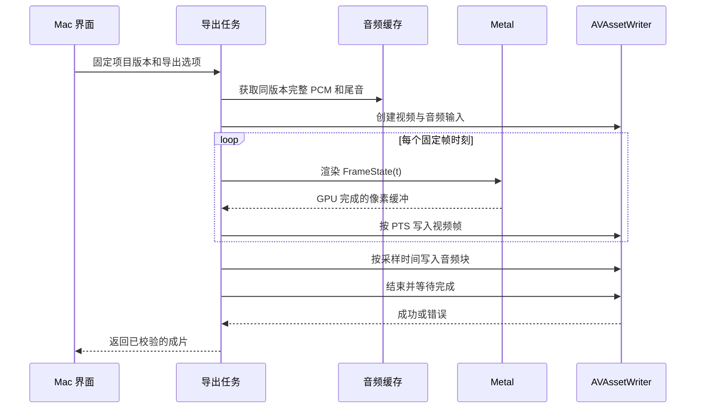

# 音频播放与视频导出

## 音画共用的时间模型

系统保存三层时间：有理数的曲谱拍值、反复展开后的演奏时间、最终媒体采样或视频时间。声音、光点、拖尾和镜头必须从同一个 `PerformancePlan` 得到时间，不能各自依据 Timer、屏幕刷新和排版库 MIDI 输出计时。

先展开演奏结构，再解释速度、装饰音、奏法与配器，最后量化到音频采样点。延音链只生成一次起音；连奏线允许多个真实起音。静音、独奏或换乐器不能改变其他声部的全曲拍轴。

连奏组与延音链的身份同时传给视觉层，作为允许连线的必要条件；音频包络、踏板尾音或音符时值重叠不额外创建视觉连接。延音链中后续印刷符头的激活只推动视觉进度，不新增 note on；分离音符的光点可以移动而不生成拖尾。

设 `b` 为四分音符拍，`q(b)` 为 QPM，则：

```text
t(b) = integral(60 / q(b), db)
sample(b) = round(t(b) * sampleRate)
```

逐个事件从高精度绝对时间计算采样点，不能把每个已舍入音符时长累计相加。线性 QPM 渐变需要积分，不是取两端速度的算术平均。恒速 q 时，某段拍长 Δb 的秒数为 `60 × Δb / q`；线性渐变可使用解析对数积分，或误差受控的数值积分。

MusicXML 八度显示线表示谱面相对实际音高的位移；`pitch` 已是演奏音高，不能在播放时再加减一个八度。当前解析器允许合法 `octave-shift` 并保留原谱供排版，完整《致爱丽丝》的 8va 段已纳入验证。[MusicXML 八度线定义](https://www.w3.org/2021/06/musicxml40/musicxml-reference/elements/octave-shift/)

延长记号、自由延长、无计量反复需要明确的演奏解释。例如延长记号默认乘数 1.5、未给定速度默认 96 QPM，并在导入报告中显示。它们是应用默认值，不应宣称由乐谱唯一决定。渐慢、Swing、装饰音、移调和踏板均以独立能力声明，未实现的影响发声特性不能静默省略。

## 乐器合成路线

首版使用 `AVAudioEngine`、多个 `AVAudioUnitSampler`、声部混音和总线混响。Sampler 可加载 SF2 或 DLS，音源加载涉及文件和内存分配，必须在准备阶段完成。[Apple 音源加载接口](https://developer.apple.com/documentation/avfaudio/avaudiounitsampler/loadsoundbankinstrument(at:program:bankmsb:banklsb:))

```text
旋律钢琴实例 ─┐
旋律小提琴实例 ├─ 声部增益与声像 ─ 总线混音与混响 ─ PCM
钢琴伴奏实例 ─┘
```

同一种乐器也可能需要多个实例：不同声部具有独立踏板、控制器、释放归属或同音高重叠时，不能只按 program 合并。实例池可以复用空闲节点，但必须先证明没有残留音符、踏板和控制状态。

当前总线为 sampler → 独立混音节点 → 中等房间混响 → 主混音节点。混响使用原生 `AVAudioUnitReverb`，默认 12%，可关闭；与声音一起写入 PCM，预览和导出听到相同的空间效果。[Apple 混响接口](https://developer.apple.com/documentation/avfaudio/avaudiounitreverb)

Mac 离线合成在加载音源之前，将每个原生采样器的公开 `kMusicDeviceProperty_StreamFromDisk` 属性设为 `UInt32(0)`，检查返回状态；保留 `isRenderingOffline = true`。本机对照显示，单独设置离线提示仍让磁盘流式读取保持开启，快速渲染越过初始预载区间后可能输出异常采样。关闭流式读取，让音源在准备阶段驻留，避开已经复现的流式采样异常。音源驻留会增加内存需求，因此继续保留每组最多 8 个实例的限制；其他 macOS 版本仍须实测。

原始 PCM 在写入缓存和计算峰值之前检查采样有效性，分组后的实际混音与参考混音也检查。NaN、Infinity 或导致能量溢出的异常值会让准备失败并清理本次输出；不能把坏值置零、跳过音符、降低验收门槛或通过重试掩盖。最大幅值计算本身不能可靠发现 NaN，因此不能作为唯一有效性检查。

实际实现将每个离线引擎限制为最多 8 个独立乐器实例；更多实例或使用独立声部音量时分组生成临时 CAF，每组保留原始增益、声像、踏板及采样起点，再按采样位置相加。各组使用相同房间参数，统一进行输出校准。以最长尾音补齐输出；成功、失败和取消均删除自有分组缓存。首版最多 128 个实例，大编制的准备时间与临时磁盘占用相应增加。

### 独立声部音量与默认输出

设置面板提供总音量 0%–100%，每个 part 下的每个 voice 提供独立 0%–400% 音量。按 `(partId, voiceId)` 区分，声部音量是对合成后的线性幅度调节，保留原谱力度、奏法、音高、时值和视觉光点；不会通过改 MIDI velocity 改变音色层。用户首次修改内置示例的音量时，沿用自动创建个人工程副本的流程。

默认输出以整曲参考混音的峰值校准到约 −1 dBFS，最多提升 24 dB，统一提升偏小的钢琴、小提琴等音源。该增益作用于整首曲子，保留内部强弱变化；不按小节或音符逐段抬高。它属于峰值校准，不承诺所有曲目的主观响度或 LUFS 一致。

为避免自动校准抵消用户调低声部，合成同时累计两路混音：所有声部音量设为 100% 的参考混音，以及实际声部音量的混音。校准系数取自参考混音；当实际混音过大时，再统一衰减以保护 PCM 峰值。最后乘总音量，因此总音量和全部声部一起调低仍会降低实际输出；0% 输出精确静音。预览与 MP4 共用这一份最终 PCM，音量设置包含在缓存键中。

拖动滑杆时本地显示百分比，松开后准备新的声音；键盘调节也提交设置。准备完成后恢复调节前的播放位置和播放／暂停状态。播放器不会为一次音量调整跳回开头。

### 钢琴与小提琴的差别

钢琴重点是力度层、复音、踏板、释放音及声音自然衰减。小提琴还涉及持续音包络、连奏、断奏、表情和揉弦。首版先提供稳定的采样音色与基础门控，避免把所有长音都按钢琴短音处理；进阶 legato 和多奏法音源另设里程碑。

选择“小提琴”不能自动让钢琴曲变成符合独奏小提琴演奏法的编配。和弦、音域或同时音数超出所选乐器的现实能力时，保留用户配器并提示；默认不偷偷删音或移调。音域自动调整和自动改编属于后续显式功能。

内置音源需要可验证的分发许可，并随资源清单保存版本与内容哈希。不能依赖用户机器上一个未公开、可能不存在的系统音源绝对路径。首版不支持第三方 AU 插件，以减少离线渲染、跨机重现和后续 iOS 迁移的不确定性。

## 首版播放采用离线合成缓存

建议流程为“编译演奏计划 → 合成 PCM 到磁盘 → 播放 PCM 并显示对应画面”。这样预览和导出复用同一份声音，暂停、定位和反复段落更容易保持一致。首次准备可能需要等待，界面提供进度与取消；性能数据在原型测量后再决定是否实现分段后台准备。

`AVAudioEngine` 支持由应用驱动的离线手动渲染，适用于此合成及混音路径。[Apple 离线音频示例](https://developer.apple.com/documentation/avfaudio/performing-offline-audio-processing)

### 事件调度

离线合成不能让 `AVAudioSequencer` 或普通定时器按墙钟跑，而让音频渲染循环另按最快速度跑。

初始候选包括 `AUAudioUnit.scheduleMIDIEventBlock`。首版实际采用下述事件边界拆分方案，不依赖该调度块的未验证行为。[Apple 调度接口](https://developer.apple.com/documentation/audiotoolbox/auaudiounit/schedulemidieventblock)

在事件采样边界拆分离线渲染：拉取到边界前的帧，应用边界上的控制器、note off 和 note on，再拉取下一段。使用明确的同时间事件顺序，确保重新起音前先结束旧音；踏板释放、program 切换等按所属实例处理。实际实现通过脉冲音源检查，记录解码后的固定偏移。极密集音符可能降低拆分渲染效率，不能仅因此改用误差不明的整块量化。

默认 48 kHz、双声道、Float32 PCM。合成过程按小块写 CAF 或 WAV，不把整首音频常驻内存。每分钟此规格原始 PCM 约 23 MB，五分钟约 115 MB；这只是数据量计算，不代表实际缓存总占用。

### 踏板和尾音

对钢琴分别保留 key off、踏板释放和最终声学衰减。小提琴按音源释放包络结束。最后一个记谱音符结束后继续渲染至声音低于可配置阈值并持续一段时间，或达到受控上限；超限时提示并使用短淡出。

`export.tailSeconds` 定义最后一个音乐门控事件之后至少保留的成片时间，不允许它截断已经检测到的必要尾音。初始可采用最少 2 秒、额外尾音最多 10 秒的保护策略，阈值和上限在音源验收中调校。重新渲染相同音源时，尾音算法与版本进入缓存 key。

## 播放控制与时钟

准备后用 `AVAudioPlayerNode` 播放 PCM，从播放器的有效 sample time 推导媒体位置。`playerTime(forNodeTime:)` 是节点时间到播放器时间的转换入口，暂停、重新 schedule 和设备切换后要重建时间基准。[Apple 播放器时间接口](https://developer.apple.com/documentation/avfaudio/avaudioplayernode/playertime(fornodetime:))

可视状态依据“该帧预计呈现时正在被听到的音频位置”计算，同时考虑硬件输出延迟、音频缓冲和显示呈现延迟；不能把 render sample cursor 直接当成用户已经听到的位置。蓝牙耳机的额外延迟需要单独测量和可选校准，不能沿用内置扬声器的结论。

拖动进度直接读取 PCM 的目标位置，并按绝对时间重建画面。由于 PCM 从头合成，定位到踏板或长音中间仍能听到正确的声音状态。若未来改成实时音符合成，定位必须重放或恢复踏板、控制器与持续音状态，不能只触发目标时间之后的音符。

播放状态机建议为：`empty → importing → preparing → ready → playing / paused → ended`，另有 `failed` 与可取消任务。修改配器、全曲速度、力度或混响会生成新的 audio generation；首版在安全暂停点准备新音频。只改光点颜色或相机时不停止声音。

音频设备切换、采样率变化、休眠或引擎配置变化时，暂停并保存项目采样位置，重建播放图后恢复。关闭窗口取消该文档任务，不让旧回调继续修改新窗口。

## 视频导出管线



导出的视频和音频可由独立生产队列交错送入，避免一个输入等另一个输入而死锁；示意图的先后顺序不代表必须写完整段视频后才送音频。

### 帧时间

帧率写作 `fps = n / d`，第 k 帧 PTS 为 `k × d / n`。使用 `CMTime` 的整数分子和分母，不累计 Double 秒差。60 fps 时第 k 帧为 `CMTime(value: k, timescale: 60)`。首版提供 30 和 60，格式为以后保留 `30000/1001` 等有理帧率。

设合成音频最终有 S 个采样，采样率 R，则视频帧数为 `ceil((S/R) × n/d)`。需要时把音频末尾补静音到最后一个帧区间的末端；音乐之前不插入意外的起始延迟。结束判断包含尾音，不能按曲谱最后一个 note on 截止。

### 图像到编码

Metal 离屏渲染至 Core Video 可用的像素缓冲，使用 `CVMetalTextureCache` 在两套资源之间建立纹理映射。最终帧经色调映射成为 SDR Rec.709 输出，固定编码色彩标记，验证导出播放器中的纸面亮度与光晕。[Core Video 纹理缓存](https://developer.apple.com/documentation/corevideo/cvmetaltexturecache)

使用 `AVAssetWriter` 封装音频和视频，首版目标为 MP4、H.264、AAC、48 kHz 双声道。编码前检查目标设备支持的设置；不把某台 Mac 的编码速度视为所有机器的保证。[Apple AVAssetWriter](https://developer.apple.com/documentation/avfoundation/avassetwriter)

Writer 兼容层可在目标系统支持时使用新的像素缓冲 receiver，在旧系统使用 pixel buffer adaptor。具体可用性和弃用状态以建立工程时选定 SDK 为准；不能把最新文档中的新接口直接当成 macOS 14 可用接口。[像素缓冲适配器](https://developer.apple.com/documentation/avfoundation/avassetwriterinputpixelbufferadaptor)

### 背压与失败

编码器暂时不能接收时，等待而不丢帧。保持有限的在途像素缓冲，GPU 完成后才提交，writer 不再使用后才复用；避免整片帧图驻留内存。导出可以比实时慢，预览丢帧不能传递成导出缺帧。

成片先写到输出目录中的临时文件。运行时检查所有输入完成、writer 成功、实际轨道、尺寸、帧率、声道、采样率与时长，再替换最终文件；输入 PTS 由整数帧号构造并按顺序提交。开发验收另对完整文件解码，逐帧检查 PTS、帧数和音画落点，避免每次正常导出重复解码整段视频。保存位置已有文件时，使用用户正常保存操作选择的覆盖规则。

取消时停止生产，等待安全释放 GPU 与编码资源，删除本次临时输出；不能删除原项目或上一次成功视频。磁盘不足、资源缺失、音频中止、编码错误和应用退出均有独立错误说明。首版失败重试从头开始，后续再考虑分段恢复，避免承诺无法可靠接续的编码状态。

## 可验证的同步标准

用零攻击延迟的测试音源生成脉冲，并让对应音符着陆帧显示可检测标记。对导出的解码音频和视频测量，目标为相对同步误差不超过一帧加一个音频采样，长片首尾没有累计漂移。还要验证 AAC 编码延迟和容器 edit list 的解码结果。

正式小提琴音源具有自然起音包络，不能以波形最大值与 MIDI note on 的差值直接判为同步错误。正式音源验收同时观察控制事件时间与听感，并单独记录音源固定延迟。预览同步需要实际扬声器或耳机测量；仅检查导出 PTS 不代表设备播放已经通过。
